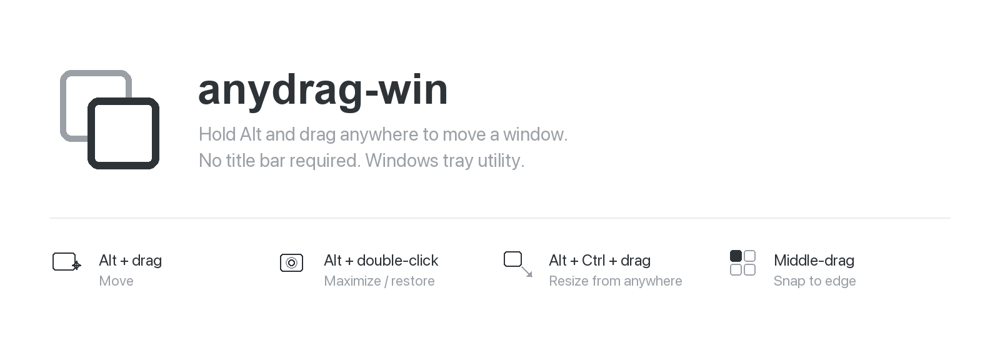
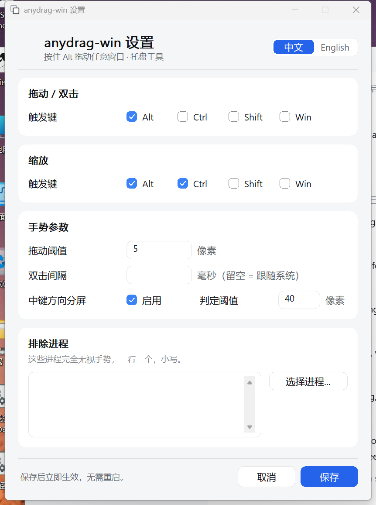
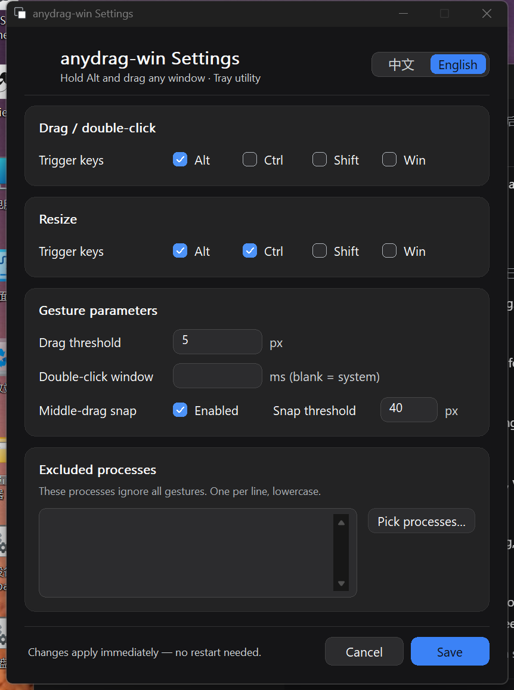

[English](README.md) · **中文**

Windows 版「Alt 拖窗口任意点移动」小工具：把鼠标光标停在**任意窗口的任意位置**，
按住 **Alt 拖动**即可移动该窗口（不限于标题栏）；**Alt 双击**则最大化/还原；
**Alt+Ctrl 在窗口任意位置拖动**则调整大小（方向自动判定，不用瞄边缘）。
行为参照 AnyDrag(macOS) 与 AltSnap(Windows) 的交互，clean-room 实现，MIT 许可。
运行后常驻系统托盘，无安装、无运行时依赖，几百 KB 的单个 exe；
**没有主界面**，交互就是手势 + 托盘菜单（设置窗口按需从托盘打开）。

## 快速开始

```bat
:: 需要 Rust 工具链 + MSVC x64（Visual Studio 2022 BuildTools 或 Community 均可）
cargo build --release

:: 运行（Release 产物）
target\release\anydrag-win.exe
```

> `cargo build --release` 就够了 —— 图标与 manifest 由 `build.rs` 调 `rc.exe` 内嵌，
> 它会自己去 Windows SDK 的 include 目录找头文件，**不需要**先跑 `vcvarsall.bat`。
> `build.bat` 只是个便利脚本（帮你 call vcvarsall 再 build），适合本机固定装了
> BuildTools 的人；装了 Community 版或换了路径时直接用上面的 cargo 命令。

运行后任务栏右下角托盘出现本程序的图标（与 exe 图标同一个：两个错位圆角方块）。
没有主窗口——所有交互都是"手势 + 托盘菜单"，设置窗口从托盘菜单按需打开。

## 用法

### 手势（对**任何**窗口生效，光标在哪、就操作哪个窗口）

| 手势 | 效果 |
| --- | --- |
| 按住 **Alt + 鼠标左键**，从光标处拖动 | 移动光标下那个窗口（移动的是窗口，不是内容） |
| **Alt + 双击**（两次点击间隔 < 系统双击时间、几乎不位移） | 该窗口**最大化** |
| 对已最大化窗口再 **Alt + 双击** | **还原**到之前大小位置 |
| 按住 **Alt + Ctrl**，在窗口**任意位置**拖动 | 调整该窗口大小（方向按光标位置自动判定，**不用瞄边缘**） |
| 按住**中键**朝某个方向拖拽后松开 | 窗口**吸附分屏**：朝左右 → 左右半屏；朝上下 → 上下半屏；朝斜角 → 四分之一屏 |

- 判定以「Down 事件时刻光标下的窗口」为准，因此你可以把窗口拖出屏幕边缘再拉回来
  （这是标题栏拖不了的最大价值场景）。
- ⚠️ **Alt + 双击请点在窗口的内容区，别点在标题栏**：Windows 自带
  "Alt+双击标题栏 = 关闭窗口" 快捷键，它会抢先于本工具把窗口关掉
  （系统行为，任何全局钩子都拦不住）。
- **Alt+Ctrl 缩放不需要贴边**：把窗口想成九宫格——抓左/右列就横向缩放、抓上/下排就
  纵向缩放、抓正中间就取**就近角**。抓哪儿都能缩，这正是它比"自己去找窗口边缘"强的地方。

### 拖动是怎么实现的（一句话版）

所有应用的拖动都走同一条路：引擎按光标位移算目标矩形，用 `SetWindowPos` 下发，
并成对发送 `WM_ENTERSIZEMOVE`/`WM_EXITSIZEMOVE` 让目标应用把重排推迟到松手，
外加节流与背压防止灌得比应用重排得快。

项目早期还有第二条路（远程 `SC_DRAGMOVE`，让目标应用自己跑原生拖动循环），
**已于 2026-10-21 移除**：它只在 explorer/mspaint 等部分应用生效，其余完全拖不动
且毫无报错，而 `SetWindowPos` 对所有应用都生效。详见 `AGENTS.md` §4。
- 拖动阈值 5px、双击窗口默认跟随系统（`GetDoubleClickTime`），可配置（见下）。
- **中键分屏不会影响普通中键点击**：只有拖拽位移超过阈值（默认 40px）才吸附，
  没拖动就松开 = 原样交给应用（中键粘贴/滚动照常）。不需要可在设置里关掉。

### 托盘菜单（左键或右键点托盘图标）

| 菜单项 | 行为 |
| --- | --- |
| **启用 / 禁用** | 即时切换手势开关，**写回配置文件并换图标**：禁用时图标整体变淡 + 提示"已禁用"，随时可再切回 |
| **设置…** | 打开**图形设置界面**（触发键、阈值、排除名单、中键分屏、界面语言），保存**立即生效，无需重启** |
| **用法…** | 弹窗显示上面的手势说明与配置文件路径 |
| **配置文件…** | 用系统默认编辑器打开 `config.json`（文件不存在时先写出模板） |
| **退出** | 移除托盘图标、退出进程（鼠标钩子随进程退出自动卸载） |

托盘图标就是**程序图标**（两个错位圆角方块），与 exe / 任务栏 / Alt+Tab 里的图标同一个，
一眼能认出是哪个程序。状态用**不透明度**表达：原色 = 手势生效中，整体变淡 = 已禁用。

> 为什么状态用"变淡"而不是"变色"：程序图标是多色的（白填充 + 炭黑描边 + 中灰后层），
> 没有一种颜色能安全地表达"禁用"——换色会破坏它与 exe 图标的一致性，而一致性正是
> 用程序图标的初衷。降低不透明度对任何配色都成立，且"变淡 = 不生效"比"变灰"更直观。

图标**内嵌在 exe 的 PE 资源段里**（`assets/app.rc` + `build.rs`），所以 exe 是**单文件**，
不需要旁边的 `.ico` 或 `.manifest`。

### 设置界面

托盘菜单「设置…」打开的窗口（也可以 `anydrag-win.exe --settings` 直接开），可改：
拖动/双击的触发键、缩放的触发键、拖动阈值、双击间隔、中键分屏开关与阈值、
"完全无视手势"的进程名单（点「选择进程…」从当前窗口列表勾选，也可手填）。
**点保存立即生效**——配置热重载到引擎线程，触发键也会同步给鼠标钩子，不需要重启进程。

**界面语言**：右上角「中文 / English」分段按钮，**点了立即变**（不重开窗口、
不丢已输入的内容）；点「取消」回滚。首次运行跟随系统语言，之后记住你的选择
（`config.json` 的 `lang` 字段；留空 = 继续跟随系统）。**托盘菜单、tooltip、
「用法…」弹窗同样双语。**

**深色主题**：跟随系统「应用模式」设置，**切换后窗口立即重绘**（不重启）。
配色与圆角遵循三条可验证的原则：中性色带极轻微蓝调（纯灰会显脏）、
边框用半透明黑/白（实色灰在任何背景上都显厚重）、圆角按用途分三级（4/8/12px）。
全部符合 Windows 11 类型刻度与 WCAG 2.1 对比度要求（后者由单测强制）。

**键盘可用**：Tab / Shift+Tab 在控件间移动，空格切换复选框，回车触发「保存」，Esc 取消。

| 中文 · 浅色 | 英文 · 深色 |
|---|---|
|  |  |

## 配置

文件：`%APPDATA%\anydrag-win\config.json`（托盘"配置文件…"可直达）。
**改完立即生效，无需重启**（设置界面保存 / 直接手改文件都走热重载，见下文）。
文件缺失或 JSON 损坏 → 按默认值运行，不报错。

| 字段 | 类型 | 默认 | 说明 |
| --- | --- | --- | --- |
| `enabled` | bool | `true` | 总开关。`false` 时钩子仍装但所有手势无效果 |
| `modifiers` | `VK 码数组` | `[18]`（=Alt） | 要求"全部按下"才触发；`18`=Alt、`2`=Ctrl、`1`=Shift、`3`=Win |
| `resize_modifiers` | `VK 码数组` | `[17, 18]`（=Ctrl+Alt） | 缩放的触发键组合，要求**全部同时按下**；在窗口任意位置按下即生效（方向按九宫格/就近角判定，不需贴边）。`[]` = 关闭缩放 |
| `drag_threshold_px` | 像素 | `5` | 位移达到才提交拖动，否则视为双击候选 |
| `double_click_ms` | 毫秒 / `null` | `null`（跟随系统） | 双击判定窗口；显式给定则覆盖系统值 |
| `native_excluded` | 进程名(小写)数组 | `[]` | 名单内应用**完全无视手势**（例如不想被全局钩子打扰的应用）。设置界面点「选择进程…」可从当前可见窗口里勾选，不必手填 exe 名 |
| `middle_snap` | bool | `true` | 中键方向分屏开关。`false` 时中键完全不干预 |
| `middle_snap_threshold_px` | 像素 | `40` | 中键拖拽超过它才判定分屏方向；没拖动就松开 = 普通中键点击 |
| `lang` | 字符串 | `""` | 界面语言：`""` = 跟随系统，`"zh"` / `"en"` = 显式指定 |

进程名示例：`notepad.exe`、`explorer.exe`、`msedge.exe`、`code.exe`。

最小配置（其余字段省 = 默认）：

```json
{
  "modifiers": [18],
  "native_excluded": ["game.exe"]
}
```


### 配置文件改动何时生效

改 `config.json` 有两条路径，**都不需要重启程序**：

1. **设置界面点"保存"** —— 走 `config::replace()`，版本号自增；保存动作还会显式
   向引擎线程投递一条空 `WM_APP` 把它从 `GetMessageW` 的阻塞中叫醒，所以**不用
   先动一下鼠标**才生效。
2. **直接手改文件** —— 引擎每批事件比对文件 mtime，变了就重新载入（2026-10-21 加入）。
   修复前手改**完全无效**：引擎只认版本号，会一直用启动时的内存快照，
   表现为"我明明改好了，怎么还是不对"，只有重启进程才生效。

   `ANYDRAG_DEBUG=1` 下会打印 `[config] 已重载（file_changed=true）mods=[...]` 便于确认。

**改触发键要注意**：引擎靠"钩子监视列表与配置一致"自愈，且比较是**内容级**的
（`hook::mods_match`）。把 Alt 换成 Ctrl 这种"个数不变"的改动同样会刷新钩子键表
——修复前只比长度，会误判成"没变"，导致改完第一次手势静默失效。

## 已知边界（MVP 范围）

- **高权限窗口看不见**：以管理员运行的进程（如管理员 cmd/explorer 场景）的窗口
  无法取进程名，会被跳过（安全限制，非 bug）。
- **Secure Desktop 失效**：UAC 提权弹窗等 Secure Desktop 上钩子不生效。
- **全屏游戏建议加入 `native_excluded`**：全局鼠标钩子会向游戏进程投递事件，
  个别独占全屏/反作弊程序可能拒之不理或报警，加入排除表最稳。
- **多显示器**：坐标统一物理像素（Per-Monitor-v2 DPI 感知），跨屏拖动可用；
  最大化判定按"窗口所属显示器的工作区"。
- **Win11 打包应用**（notepad 等）：其宿主辅助窗会劫持命中测试，本工具已用
  Z 序候选扫描规避（实测不移动、不点错窗）。
- 配置**已全量支持热重载**：设置界面保存与直接手改文件都即时生效，无需重启
  （2026-10-21 补齐手改路径；此前只有设置界面保存会生效）。
- 只有一份实例：多开只会装多条钩子、无收益。

## 开发

> **改这个仓库前先读 [`AGENTS.md`](AGENTS.md)** —— 架构不变量、配置热重载机制、
> 已移除的设计（及为什么移除）、以及 26 条实测踩过的坑（定时器炸弹、背压闩锁死锁、
> 事件环溢出、异步 placement 不一致态、GDI 不吃 alpha、`IsDialogMessageW` 不完成
> Tab 焦点循环……）都在里面。

```bash
cargo test                  # 92 个单测（纯逻辑模块零 windows-sys）
cargo build --release       # release 构建（图标/manifest 由 build.rs 内嵌）
```

**完整测试流程见 [`docs/testing.md`](docs/testing.md)** —— 含环境准备、单元测试、
真机手势冒烟（四项手势 + 探针判据）、真实场景回归、结果回填模板，
可直接交给另一台机器上的 agent 照着执行。

冒烟驱动：`target/release/probe_gesture.exe`（`frame|alt-drag|alt-dbl|ctrl-resize|middle-snap|maximize|send-save|close`，
自动化验收用，非用户工具；跑之前它会先确认目标窗在最前，否则直接中止，避免误伤别的窗口）。
诊断日志：`ANYDRAG_DEBUG=1` 运行时打印到 stderr（GUI 子系统下从 cmd 启动仍可见；
心跳行含 `dropped=` 与 `state=`，是判断事件环溢出/状态滞留的第一手指标）。

### 图标

- **exe 文件图标**：两个错位圆角方块（后层灰描边空心、前层白填充+炭黑描边），
  表达"一个窗口被挪到了另一个窗口上"。
  **由脚本生成、不是手工调的二进制**：`python3 assets/icon-src/build_ico.py`
  可重现地重建 `assets/anydrag-win.ico`（7 个尺寸逐尺寸独立光栅化，
  这是小尺寸不糊的前提）。设计与取舍见 `assets/icon-src/README.md`。
- **托盘图标**：**同一个程序图标**（`src/icon.rs` 从 PE 资源段按托盘尺寸加载，
  见上节「托盘菜单」）。状态用不透明度表达（原色=启用，45% 不透明度=禁用）。
  多尺寸 `.ico` 让 Windows 能挑到对应那一帧，而不是拿 32px 缩到 16px（会糊成灰边）。
- **README 头图**：`assets/hero.png`，同由脚本生成（`assets/icon-src/hero.py`），
  文字用真实字体渲染而非 AI 出图（AI 会把文字画成乱码）。
- **视觉样式清单**：内嵌进 PE 资源段（`assets/app.rc`）。`build.rs` 调 Windows SDK 的
  `rc.exe` 编译后经 `cargo:rustc-link-arg` 交给链接器，**不引入任何 Rust 构建依赖**
  （不用 winres/embed-resource）。
  `build.rs` 会自己扫 Windows SDK 的 include 目录传给 `rc.exe`，**不依赖
  `vcvarsall.bat` 设的 `INCLUDE` 环境变量** —— 否则直接 `cargo build` 时会找不到
  `winres.h`，资源编不出来而构建"成功"，exe 里既没图标也没清单。
  若真的找不到 `rc.exe`，构建会打一条 warning 并跳过（不阻断），
  但那样产出的 exe **没有图标也没有 DPI 清单**，不建议分发。

  因此 **exe 是单文件可分发**：不再需要旁边的 `anydrag-win.exe.manifest`。
  清单以 `RT_MANIFEST` / ID=1（进程级）内嵌，且**必须包含 `PerMonitorV2`**：
  缺了它进程在 150% 缩放下按 96 DPI 虚拟化，设置窗口会被裁掉一半。
  若退回外部文件模式，一旦漏拷就会静默退回 Windows 95 灰色控件样式且无任何报错。

## 许可

MIT，全文见 [`LICENSE`](LICENSE)。

交互设计参照 AnyDrag（macOS）与 AltSnap（Windows）的行为，但**代码为 clean-room
独立实现**，未复制其源码。
