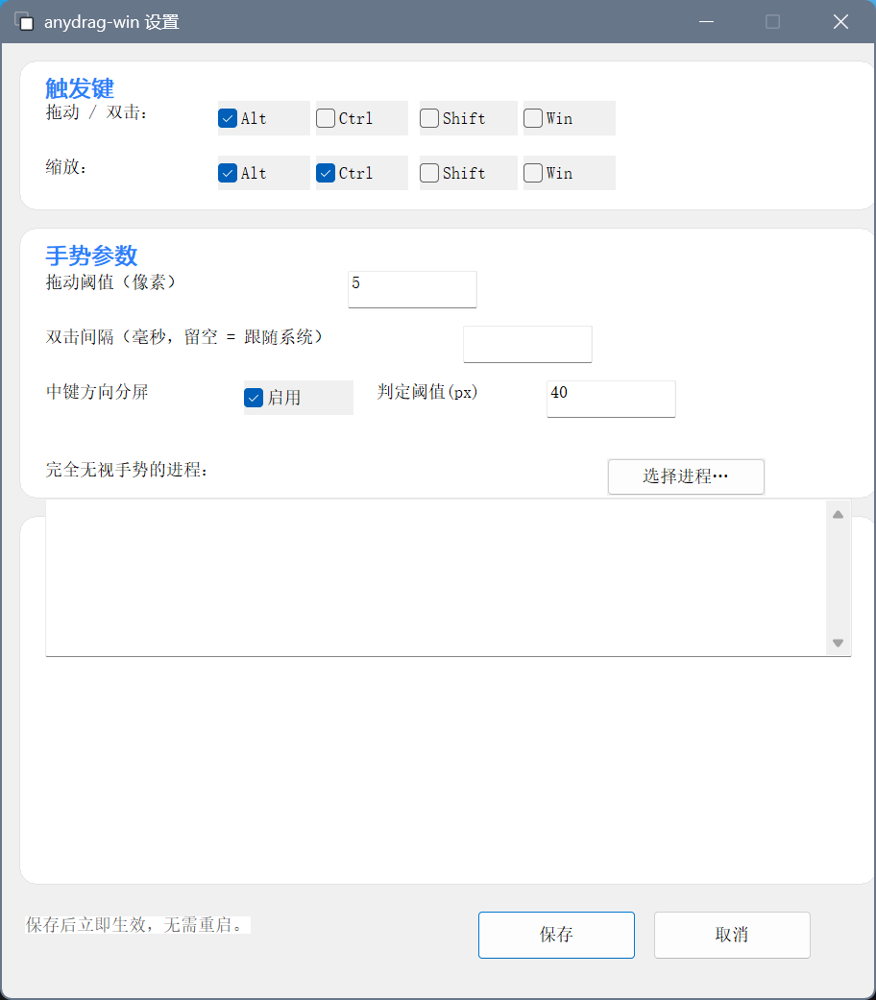

# SPEC — 设置界面重做 + 中英双语切换

- **状态**：待实施（本文件是规格，不含实现）
- **日期**：2026-10-23
- **目标读者**：下一个会话执行改动的 agent
- **相关性**：`AGENTS.md` §1 不变量 4 / §6 坑 #18 #21、`docs/testing.md`

> 本文件回答"做成什么样、为什么、怎么验收"。实现细节留给执行者，
> 但**验收条件与不变量是硬约束**，偏离必须回头改本文件。

---

## 1. 背景与用户诉求

用户原话（2026-10-23）：

> "把GUI改改，也不好看，而且要加上中英双语切换"

两件事：**外观重做** + **中英双语切换**。

### 1.1 现状实测（不是凭印象）

启动 `anydrag-win.exe --settings`，按 DWM 帧截取完整窗口（912×1041 @150% DPI，
即 608×694 逻辑像素）：



逐条列出实数问题（每条都在截图里可见）：

| # | 问题 | 证据（已核对 `src/settings.rs` 实际坐标，非目测） |
|---|---|---|
| U1 | **「完全无视手势的进程：」这个标签画进了上一张卡片里**：标签在 `y=290`，而第 2 张卡片「手势参数」的白底范围是 `y=128..316` —— 标签压在卡片 2 的白色区域底部，与「手势参数」的内容混在一起；它本该属于卡 3（`y=328..584`） | `settings.rs:490` `label(..., 30, 290, 300)` vs `CARDS[1] = (…, 12, 128, 596, 188)` |
| U1b | **卡 3 的标题与它唯一的说明性标签重复且错位**：卡 3 标题是「进程名单（一行一个，小写）」（自绘），外侧又有一个黑字标签「完全无视手势的进程：」，两者说同一件事 | `CARDS[2]` 标题 + `settings.rs:490` |
| U2 | **底部约 250px 纯空白**：窗口逻辑高 694，卡片区最低到 `y=584`，按钮行在 `y=602`，其余全空 | 截图下部大片灰底；`CARDS[2]` 底边 584 |
| U3 | **卡片标题与第一行内容挤在一起**：标题基线在 `t+9`，首行控件在 `y=40`（卡片顶 `y=12`），两者只隔 ~10px，视觉上粘成一团 | `settings.rs:175` 与 `create_controls` 的 `check(...40)` |
| U4 | **复选框视觉是灰底方块**：`BS_AUTOCHECKBOX` 用系统老位图字体，文字与方框都发虚 | 截图 "Alt/Ctrl/Shift/Win" 均带灰色底块 |
| U5 | **字体层级混乱**：卡片标题用 Segoe UI 600（`CreateFontW`），正文控件却用 `DEFAULT_GUI_FONT`（Win95 时代位图字体） | `settings.rs:395` `GetStockObject(DEFAULT_GUI_FONT)` |
| U6 | **标签与输入框拉得太开、无单位后缀**：「拖动阈值（像素）」在 `x=30`，输入框在 `x=240`，中间 210px 空档；"像素"塞在标签里而不是跟在数字后 | `settings.rs` 的 `label(...30,160...)` 与 `edit1(240,158,90)` |
| U7 | **无分组层级**：窗口没有标题区/内容区/操作区的区分，所有东西平铺 | 截图 |
| U8 | **无语言切换入口** | 功能缺失 |
| U9 | **按钮区与内容区无分隔**：保存/取消直接漂在底部灰底上，没有分隔线与边距节奏 | 截图底部 |

### 1.2 约束（来自 AGENTS.md，不可违反）

| 不变量 | 对本 SPEC 的含义 |
|---|---|
| §1-4 纯逻辑模块零 `windows-sys` | 新增的 `i18n` 模块**必须**是纯逻辑（无 FFI），否则不可单测 |
| §1-5 所有 FFI 集中在 `winmod.rs` | `settings.rs` / `tray.rs` 因自身即窗口宿主属**既有例外**，可在本文件内直接调 FFI；新代码不要引入第三处例外 |
| §1-6 `RwLock` 就地拆锁 | 新增的全局状态同理，不许 `if let Ok(..)` 静默跳过 |
| §6 坑 #18 | **文案只能有一处定义**。当前 `settings.rs`/`tray.rs` 各自硬编码中文，加双语必然漏改，这正是坑 #18 的形态 |
| §6 坑 #21 | 图标资源 ID 相关，与本 SPEC 无关但说明"静默失败必须有日志"这条精神 |

**不引入任何 GUI 框架依赖**（egui / iced / slint / wxDragon 等）。理由：

- 现状依赖只有 `windows-sys` + `serde`，release 产物 391KB 单文件。引 GUI 框架至少 +2MB 且多一层运行时。
- 本工具是**托盘小工具**，设置界面就一屏，用原生控件 + 自绘背景完全够。
- 引框架后 DPI/深色主题要为框架再调一遍，反而更不可控。

---

## 2. 设计依据（有出处，不是拍脑袋）

调研结论（权威来源，实施时可直接引用）：

### 2.1 字体与字号

来自 [Windows Typography](https://learn.microsoft.com/en-us/windows/apps/design/signature-experiences/typography)：

- Windows 11 系统字体是 **Segoe UI Variable**，备用 **Segoe UI**。
- **最小可读值：14px Semibold / 12px Regular**。"Text smaller than these sizes and
  weights are illegible in some languages."
- Windows 11 类型刻度（epx）：

  | 用途 | 字重 | 字号/行高 |
  |---|---|---|
  | Caption | Small | 12/16 |
  | Body | Text | **14/20** |
  | Body Strong | Text Semibold | 14/20 |
  | Body Large | Text | 18/24 |
  | Subtitle | Display Semibold | **20/28** |
  | Title | Display Semibold | 28/36 |

- **Casing：Sentence case**（句首大写），标题也一样。
- **不要用 Bold/Italic**，强调用 **Semibold**。Italic 降低可读性（尤其阅读障碍者）。

→ 本 SPEC 取值：正文 **14px Regular**、卡片标题 **14px Semibold**、窗口副标题
**12px Regular**、窗口主标题 **20px Semibold**。**当前 12px 正文与 15px 标题都偏小/不合刻度**。

- 中文字体：简体用 **Microsoft YaHei UI**（同页 Languages 表明确列出），
  西文用 Segoe UI。用 `CreateFontW` 的 `lfFaceName` 写 `"Microsoft YaHei UI"`
  会把英文也画成雅黑（可接受，但字形不如 Segoe）；更好的做法是**字体链接**
  （`lfFaceName = "Segoe UI"` + 系统自动 fallback 到雅黑渲染汉字）——Windows 的
  font linking 默认已配好，直接写 Segoe UI 即可正确显示中文。**实测确认后再定**。

### 2.2 颜色与主题

来自 [Color in Windows](https://learn.microsoft.com/en-us/windows/apps/design/signature-experiences/color)：

- 浅色/深色两套中性色，**对比度必须足够**。
- 强调色（accent）**只用于强调交互元素**，"Use color sparingly"。
- 无障碍：约 8% 男性 / 0.5% 女性红绿色盲，**不能只用颜色区分状态**。

→ 本 SPEC：
- 当前"卡片标题用蓝色 `#2D7FF9`"违反"accent 只用于交互元素"——卡片标题不是可点的。
  改为：卡片标题用正文色（`#1A1A1A`），**accent 只留给主按钮和焦点环**。
- 平台规范要求支持深浅色。**本 SPEC 的取舍见 §6 决策 D2**。

### 2.3 布局与间距

来自 [Design Windows apps](https://learn.microsoft.com/en-us/windows/apps/design/) 的
Layout 与 Usability 部分，以及 Windows 11 设置应用的既有视觉语言（8px 网格、
卡片式分组、句首大写）。具体值本 SPEC 在 §3.2 给出。

---

## 3. 目标设计

### 3.1 信息架构

把现在"3 张卡片 + 卡片外游离标签"重排为**4 组**，顺序按"用户最常改的在前"：

```
┌─────────────────────────────────────────────────────────┐
│ [icon]  anydrag-win                                     │  主标题 20/28 Semibold
│         按住 Alt 拖动任意窗口 · 托盘工具                │  副标题 12/16 Regular 灰
│                                    [ 中文 | English ]   │  语言切换（分段按钮）
├─────────────────────────────────────────────────────────┤  分隔线
│  ┌─ 拖动 / 双击 ─────────────────────────────────────┐  │
│  │  触发键    [✓ Alt] [ Ctrl ] [ Shift ] [ Win ]      │  │
│  └───────────────────────────────────────────────────┘  │
│  ┌─ 缩放 ────────────────────────────────────────────┐  │
│  │  触发键    [✓ Alt] [✓ Ctrl] [ Shift ] [ Win ]      │  │
│  └───────────────────────────────────────────────────┘  │
│  ┌─ 手势参数 ────────────────────────────────────────┐  │
│  │  拖动阈值           [ 5   ] 像素                   │  │
│  │  双击间隔           [     ] 毫秒（留空 = 跟随系统）│  │
│  │  中键方向分屏       [✓ 启用]   判定阈值 [ 40 ] 像素│  │
│  └───────────────────────────────────────────────────┘  │
│  ┌─ 排除进程 ────────────────────────────────────────┐  │
│  │  这些进程完全无视手势，一行一个，小写              │  │
│  │  ┌─────────────────────────────────┐ [选择进程…]  │  │
│  │  │                                 │               │  │
│  │  └─────────────────────────────────┘               │  │
│  └───────────────────────────────────────────────────┘  │
├─────────────────────────────────────────────────────────┤  分隔线
│  保存后立即生效，无需重启。        [ 取消 ]  [ 保存 ]   │
└─────────────────────────────────────────────────────────┘
```

关键改动：

- **U1/U1b 修**：「完全无视手势的进程：」不再游离在卡片外，而是并入卡 4 作为 12px
  灰色说明行；卡片标题只做标题。
- **U2 修**：窗口高度 = 内容自然高度 + 边距，不留死白。
- **U3 修**：卡片内边距统一 —— 标题距卡片顶 14px，首行控件距标题行底 12px。
- **U6 修**：单位改成跟在输入框后面的独立 `STATIC`（"像素" / "px"、"毫秒" / "ms"），
  标签列与输入框之间的空档收敛。
- **U7 修**：窗口分成三个明确的带：标题栏区（含语言切换）／内容区（4 张卡片）／
  操作区（提示 + 按钮），带之间用分隔线。
- **U9 修**：操作区有分隔线 + 上方 12px 间距，按钮右对齐。

### 3.2 度量规范（96 DPI 逻辑像素；所有坐标必须经 `s()` 按 DPI 缩放）

| 项 | 值 | 依据 |
|---|---|---|
| 窗口宽 | 560 | 内容最长行（英文 `Double-click window (ms, blank = system)` ≈ 300px）+ 输入框 100 + 内边距 |
| 外边距 | 20 | 8px 网格 |
| 卡片间距 | 12 | |
| 卡片内边距 | 16 左右 / 14 上 / 16 下 | |
| 卡片圆角 | 8 | |
| 标签列宽 | 150 | 最长标签英文 "Double-click window (ms, blank = system)" 需要放宽；**英文文案要缩短**（见 §4.3） |
| 控件行高 | 28 | 14px 字体 + 上下 7px |
| 行间距 | 10 | |
| 按钮尺寸 | 88×32 | 主/次按钮同宽 |
| 正文 | 14px Regular | §2.1 |
| 卡片标题 | 14px Semibold | §2.1 |
| 窗口主标题 | 20px Semibold | §2.1 Subtitle |
| 窗口副标题 / 卡片说明 | 12px Regular | §2.1 Caption |
| 颜色 · 窗口底 | `#F3F3F3` | |
| 颜色 · 卡片 | `#FFFFFF` | |
| 颜色 · 卡片边框 | `#E5E5E5` | |
| 颜色 · 正文 | `#1A1A1A` | |
| 颜色 · 次要文字 | `#6B6B6B` | |
| 颜色 · accent（主按钮/焦点） | `#2D7FF9` | 与 exe 图标同色系 |

> **英文文案必须能装进 150px 标签列**。`Double-click window (ms, blank = system)`
> 太长 → 改为 `Double-click window` + 右侧单位后缀 `ms (blank = system)`。
> 这是 §4.3 的具体动因。

### 3.3 控件选择

| 需求 | 方案 | 理由 |
|---|---|---|
| 复选框 | `BS_AUTOCHECKBOX` + **Segoe UI 14px 字体** | 保留原生行为（键盘/无障碍/高对比度全免费）；只换字体，不做 owner-draw |
| 数字输入 | `EDIT` + `ES_NUMBER` + `WS_EX_CLIENTEDGE` | 已有；补 `ES_NUMBER` 防非法输入 |
| 单位后缀 | 用独立 `STATIC` 放在输入框右侧，**不塞进 EDIT** | 塞进 EDIT 需要读写时剥离，易出错 |
| 语言切换 | 两个 `BS_AUTORADIOBUTTON \| BS_PUSHLIKE` 按钮 | **原生分段控件**：点谁谁选中、互斥由系统管，零自绘代码。比 owner-draw 分段按钮少 ~80 行 |
| 卡片标题 | 自绘（`paint_background` 已有机制） | 已有，沿用 |
| 主按钮 | `BS_DEFPUSHBUTTON` | 已有，回车触发 |

**为什么坚持原生控件而不是 owner-draw 全部**：owner-draw 每个控件都要处理焦点框、
键盘、高对比度主题、禁用态，代码量涨 3-4 倍且容易出视觉 bug。当前"不好看"的主因是
**布局与字体**，不是控件本身。先修布局/字体/间距，owner-draw 只在确有必要时局部用。

### 3.4 深色主题：本 SPEC 不做（见 §6 决策 D2）

---

## 4. 双语切换

### 4.1 数据模型

新增 `src/i18n.rs`（**纯逻辑，零 windows-sys**，符合不变量 4）：

```rust
pub enum Lang { Zh, En }
impl Lang {
    pub fn from_config(s: &str, system_is_zh: bool) -> Lang  // ""/"zh"/"en"，容错大小写与空白
    pub fn code(self) -> &'static str                        // "zh" / "en"
    pub fn toggle(self) -> Lang
}
pub enum Key { WinTitle, Subtitle, CardDrag, /* … */ }
pub fn tr(lang: Lang, key: Key) -> &'static str   // 唯一文案出口
pub const ALL_KEYS: &[Key];
```

**`tr()` 用穷举 `match`**：新增 `Key` 而漏写任一语言 → **编译失败**。这是编译期保证，
比运行时断言强。

> **已有一份 `src/i18n.rs` 草稿**（`git status` 显示为未跟踪 `??`，**未接入
> `main.rs`、从未编译过、未提交**）。可直接复用骨架：
>
> - 已实现：`Lang` / `Key` / `tr()` / `ALL_KEYS`（26 个键）+ 4 条单测
>   （`every_key_translated`、`translations_actually_differ`、
>   `chinese_strings_contain_chinese`、`lang_from_config_and_toggle`、`usage_body_is_multiline`）。
> - **需要按本 SPEC §3.1 重排**：草稿的键是"3 张卡片"时代的
>   （`CardTrigger` / `CardParams` / `CardExcluded`），而 §3.1 是"拖动/双击、
>   缩放、手势参数、排除进程"4 组，键名与文案都要跟着改。
> - 草稿里 `ALL_KEYS.len() == 26` 的硬断言在加/删键时会失败 —— 这是有意的
>   （逼执行者核对），保留即可，改键后同步改数字。
>
> 接入时别忘了在 `main.rs` 加 `mod i18n;`（草稿目前没接，所以没被编译过，
> 不排除有编译错误）。

### 4.2 配置

`config.rs` 的 `Config` 新增字段（`#[serde(default)]` 已在整个 struct 上，旧配置自动兼容）：

```rust
/// 界面语言："" = 跟随系统（首次运行/旧配置），"zh" / "en" = 用户显式选择。
pub lang: String,
```

默认 `String::new()`（= auto）。

**为什么存字符串而不是枚举**：`Config` 是 serde 反序列化的对外格式，存 `"zh"`/`"en"`
比存数字可读、手改配置不易错，也与既有 `native_excluded` 风格一致。枚举解析失败时
`Lang::from_config` 已有 fallback。

### 4.3 系统语言检测

`winmod.rs` 增加：

```rust
/// 系统 UI 语言是否中文（GetUserDefaultUILanguage 的主语言 ID == 0x04）。
pub fn system_is_chinese() -> bool
```

`GetUserDefaultUILanguage()` 返回 LANGID；`LANGID & 0x3FF == 0x04` 表示中文
（简体 `0x0804`、繁体 `0x0404`/`0x0C04` 都命中）。**注意 DPI 不变量 1 与本函数无关**
（它不是第一个 FFI 调用，`dpi_aware_v2()` 仍是）。

### 4.4 生效时机

| 场景 | 行为 |
|---|---|
| 设置界面点语言按钮 | **立即重绘全部文案**（不重建窗口），并写入内存 `config::replace()` |
| 点"保存" | 写盘，下次启动沿用 |
| 点"取消" | **回滚**到打开窗口时的语言（与其它字段一致：取消不保存） |
| 手改 `config.json` 的 `lang` | 下次打开设置窗口生效（托盘 tooltip/菜单在下次点击时重取） |

**实现要点**：语言切换时遍历已知控件句柄 `SetWindowTextW`，再 `InvalidateRect`
重绘卡片标题（标题是自绘的）。**不要 `DestroyWindow` + 重建**——会丢失用户已输入但
未保存的其它字段，也会让窗口闪烁。

> 需要一个 `retranslate(hwnd)` 函数：从 `Ctls` 里取每个句柄 → `SetWindowTextW(tr(...))`。
> 同时更新窗口标题（`WM_SETTEXT`）。

### 4.5 托盘也要双语

托盘菜单、tooltip 用的都是硬编码中文（`tray.rs`）：

- tooltip：`anydrag-win` / `anydrag-win（已禁用）` → `anydrag-win (disabled)`
- 菜单：启用/禁用、设置…、用法…、配置文件…、退出
- 「用法…」的 `MessageBoxW` 长文本

**统一走 `i18n::tr`**，语言取自 `config::snapshot().lang`（每次弹菜单时现算，
保证手改配置后下次点击就变）。

> 若本次时间不够，允许**设置界面先双语、托盘下一轮再跟上**，但必须在
> `AGENTS.md` 记一条 TODO，不许"改了界面忘了托盘"而没人知道。

---

## 5. 验收标准

### 5.1 自动化（必须全绿）

| # | 检查 | 方法 |
|---|---|---|
| A1 | `cargo test` 全绿，且测试数**只增不减** | 现有 57 条 + `i18n` 新增（预计 +4~5 条） |
| A2 | `cmd /c build.bat` 无 `rc.exe` warning | |
| A3 | `i18n` 模块零 `windows-sys` 导入 | `grep -n windows_sys src/i18n.rs` 必须为空 |
| A4 | 每条 `Key` 两种语言均非空串 | 单测 `every_key_translated` |
| A5 | 每条 `Key` 中英译文**不相同**（漏翻译检测） | 单测 `translations_actually_differ` |
| A6 | 中文译文含汉字 | 单测 |
| A7 | `Lang::from_config` 的空串/未知值/大小写/空白容错 | 单测 |
| A8 | 四项手势冒烟仍全 PASS | `probe_gesture` ×4（方法见 `docs/testing.md` §2.1，注意 Low IL 陷阱） |

### 5.2 视觉验收（**截图对比，不接受"看着还行"**）

执行者必须提供 `--settings` 窗口的截图，并逐条核对：

| # | 检查 | 判据 |
|---|---|---|
| V1 | 无控件压在错误的卡片上 | 每个标签/控件都落在其所属卡片的白色区域内（对应 U1） |
| V2 | 无死空白 | 窗口底边距 ≈ 20px，不是 250px（对应 U2） |
| V3 | 卡片标题与首行不相贴 | 视觉上能分辨"标题行"与"内容行"两个层级（对应 U3） |
| V4 | 正文 14px / 标题 Semibold | 与 §2.1 刻度一致，`src/settings.rs` 里**不得再出现 `DEFAULT_GUI_FONT`** |
| V5 | 120 / 144 / 192 DPI 三档**均不被裁切** | 至少 144（本机）必须验证；192 若无法测，记录为未验证 |
| V6 | 中文界面截图 + English 界面截图各一张 | 英文下**任一标签不被截断成 "…"** |
| V7 | 语言切换后**不需要关闭重开**窗口 | 点按钮立即变 |
| V8 | 点「取消」后语言回滚 | 重新打开仍是旧语言 |
| V9 | 单位后缀跟随输入框 | "5 像素" 视觉上成一组，不是隔着 200px |

### 5.3 回归（不许破坏已有行为）

- 保存后手势立即生效（`docs/testing.md` §7.1 空触发键 + §7.2 热重载往返）
- 进程选择弹窗仍可用（`LB_SETSEL`/`LB_GETSEL` 语义陷阱见 AGENTS 坑 #17）
- 托盘 tooltip 与菜单双语正确
- 主窗口不被本工具自己的手势拖动（`winmod::resolve_target` 已跳过本进程）

---

## 6. 关键决策与取舍（已定，勿擅自更改）

### D1 不引 GUI 框架 —— 见 §1.2

### D2 **不做深色主题**（本轮到浅色为止）

**理由**：Win32 原生控件（EDIT/CHECKBOX/BUTTON）不跟随 `DWMWA_USE_IMMERSIVE_DARK_MODE`，
`SetWindowTheme(hwnd, "DarkMode_Explorer", NULL)` 只覆盖部分控件且各 Windows 版本行为不一。
上一版设计注释已记过这个坑："硬跟深色会标题栏深/内容浅或反之的撕裂"。
真正做对需要全部控件 owner-draw，那是另一个量级的工程。

**代价**：深色系统主题下，窗口是浅色的。**这是已知缺陷，必须在 README 的
"已知不是 bug / 已知限制"里写明**，不要留给用户当 bug 报。

### D3 语言切换不重建窗口，只 `SetWindowTextW` + 重绘

理由见 §4.4：重建会丢用户未保存的输入。

### D4 文案统一走 `i18n::tr`，禁止在 `settings.rs`/`tray.rs` 里硬编码任何用户可见字符串

**这是硬约束**（坑 #18 的直接应用）。实施时若发现某处确实无法接入（例如
`MessageBoxW` 的标题），也必须从 `tr()` 取。

### D5 英文文案优先照顾"能装进布局"

英文普遍比中文长 1.5–2 倍。写英文文案时以"150px 标签列能放下"为准，宁可拆成
"标签 + 单位后缀"，不要写长句。见 §3.2 的动因说明。

---

## 7. 实施顺序（建议）

1. **先量后改**：在 `settings.rs` 里把布局参数提成常量表（`LAYOUT`），不在散落的
   数字里改。这一步不改行为，跑 `cargo test` + 截一张图确认没变。
2. `i18n.rs` 定稿：按 §3.1 的分组重排 `Key`，补齐中英文案，跑单测。
3. `config.rs` 加 `lang` 字段 + 单测（旧配置缺字段能加载）。
4. `winmod::system_is_chinese()` + 单测不了（FFI），靠 `--settings` 实机确认默认语言。
5. `settings.rs` 重排布局 + 换字体 + 加语言分段按钮 + `retranslate()`。
6. `tray.rs` 接 i18n（菜单、tooltip、用法弹窗）。
7. 截图验收（§5.2），把截图放进 `docs/spec-assets/`。
8. 更新文档：`AGENTS.md`（若新增坑）、`README.md`（已知限制：浅色即全部 +
   语言切换说明）、`docs/testing.md`（新增 §5.4 设置界面外观验收）。

---

## 8. 风险与已知坑（实施前必读）

| 风险 | 说明 | 对策 |
|---|---|---|
| R1 布局随语言变长而崩 | 英文比中文长，容易把输入框挤出窗口 | 窗口宽度按**英文**量；`§5.2 V6` 强制截图核对 |
| R2 字体链接 | 写 `Segoe UI` 时中文靠系统 font linking 落到雅黑。**若某机器上汉字变成方块**，改 `lfFaceName` 为 `Microsoft YaHei UI` | 实测 144 DPI 下的中文截图 |
| R3 `CreateWindowExW` 同步触发 `WM_CREATE` | 坑 #15：在 `WM_CREATE` 里存句柄时，外层赋值可能还没执行 | 沿用现有的"拆两个静态"写法 |
| R4 跨进程读控件被 UIPI 过滤 | 坑 #16：外部脚本读不到 EDIT 内容，验证必须用 `SendMessageTimeoutW(WM_GETTEXT)` 或进程内验证 | 验收脚本别用 `GetWindowTextW` 读别的进程 |
| R5 `BM_CLICK` 是**切换**不是"设为勾选" | 上一轮实测踩过：想把复选框设为未勾选，结果把未勾的勾上了 | 验收脚本先 `BM_GETCHECK` 再决定点不点 |
| R6 低完整性标签 | 坑 #19：从工作区启动的 exe 是 Low IL，托盘装不上、探针注入无效 | 复制到 `%TEMP%` 并 `icacls /setintegritylevel Medium` |
| R7 测试数变化 | AGENTS/README/testing.md 都写了 57 | 改动后**同步三处**，且别用 `grep -c '#[test]'`（坑 #20） |

---

## 9. 不在本 SPEC 范围

- 深色主题（D2）
- 托盘图标再改（已定稿为程序图标）
- 高对比度主题支持
- 设置窗口的键盘 Tab 顺序优化（若实施中顺手可做，但不作为验收项）
- 任何手势逻辑改动

---

## 10. 附：现状截图存放

实施时请把改动**前/后**截图放 `docs/spec-assets/`，命名：

```
docs/spec-assets/settings-before.png        # 当前（本 SPEC 已引用的那张）
docs/spec-assets/settings-after-zh.png      # 改后 · 中文
docs/spec-assets/settings-after-en.png      # 改后 · 英文
```
